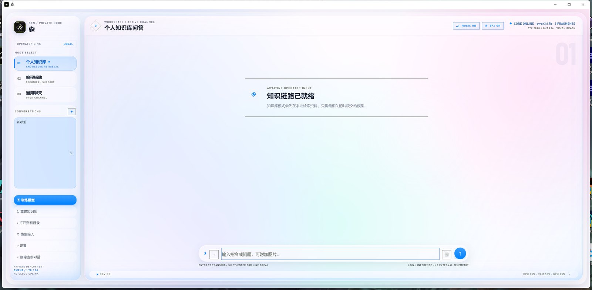

# 森 · 本地 AI 助手

在你自己电脑上运行的 AI 助手。对话、看图、画图、训练模型都在本机完成，内容不上传。
也可以接到远程 API（DeepSeek 等），完全由你决定。



## 功能

- **本地对话**：通过 Ollama 运行 Qwen3，完全离线
- **个人知识库**：把 markdown / txt 放进目录，用 BM25 检索后拼接上下文
- **看图**：附加图片，本地视觉模型理解（需另外下载视觉模型）
- **画图**：本地扩散模型出图（需完整版环境）
- **训练**：QLoRA 微调，支持暂停 / 断点续训
- **六套主题**：全息 / 纸页 / 终端 / 星舰 / 潮汐 / 液态玻璃，各带独立动效、音效和光标
- **自动更新**：启动时检查新版本，后台下载并静默安装
- **对话记录**：落盘保存，重启不丢

## 下载安装

**安装版**（推荐）：[Sen-Setup-0.1.0.exe](https://github.com/178497/sen/releases/latest)

**便携版**（解压即用）：[Sen-0.1.0-portable.zip](https://github.com/178497/sen/releases/latest)

### 前置条件

1. **Windows 10 / 11 64 位**
2. **安装 Ollama**：https://ollama.com/download
3. 首次启动时按引导下载对话模型（约 1.4 GB）

不需要安装 Python，不需要管理员权限。

### 首次启动

程序会检测两件事：

- Ollama 是否在运行 → 没有就点「已安装，启动」
- 对话模型是否已下载 → 没有就点「开始下载模型」

两项都就绪后即可对话。

## 数据与隐私

所有数据保存在 `%LOCALAPPDATA%\Sen`：

```
data\threads.json      对话记录
knowledge\             你的资料（可放 .md / .txt）
provider_config.json   模型接入配置（含 API Key 时仅存本地）
outputs\images\        生成的图片
```

默认模式下**不联网**，除非你主动配置远程 API。卸载时会询问是否保留这些数据。

## 常见问题

**Windows 提示"未知发布者"**
安装包未做代码签名。点「更多信息 → 仍要运行」即可。

**提示"LOCAL CORE OFFLINE"**
Ollama 没启动。开始菜单打开 Ollama，或在程序里点设置 → 检查本地服务。

**模型下载很慢**
`ollama pull` 走的是 Ollama 官方源。国内可在系统环境变量里设置
`OLLAMA_HOST` 或使用镜像，然后手动 `ollama pull qwen3:1.7b`。

**显卡不够 / 没有独显**
可以运行，但推理会走 CPU，速度明显变慢。建议 16 GB 内存以上。

**首次启动界面要等几秒**
启动动画本身约 3 秒；WebView2 首次初始化在安装时已经预热过。

## 从源码运行

```powershell
git clone https://github.com/178497/sen.git
cd sen
python -m venv .venv-desktop
.\.venv-desktop\Scripts\pip install -r requirements-desktop.txt
.\.venv-desktop\Scripts\python desktop.py
```

打包与发布：

```powershell
python release\build_release.py --version 0.1.1 --notes "更新内容"
python release\publish.py --rebuild
```

## 目录结构

```
desktop.py            窗口、js_api、更新器接线
server.py             对话 / 检索 / 生图 / 视觉
rag.py                BM25 索引
thread_store.py       对话持久化
image_gen.py          本地扩散模型 worker
training_manager.py   训练任务管理
updater.py            自更新客户端
static/index.html     全部界面（HTML/CSS/JS 单文件）
```

## 版本与更新

程序启动 8 秒后检查 [latest.json](https://cdn.jsdelivr.net/gh/178497/sen@main/latest.json)，
发现新版本会在右下角提示，下载完成后静默安装并重启。

## 许可

二进制发行版可自由下载使用。
源码许可待定，未授权前请勿用于商业分发。

